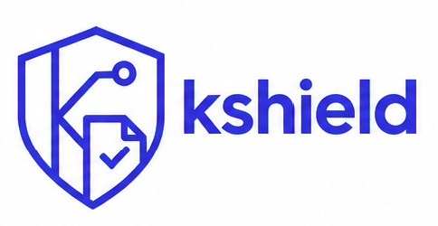

<p align="center">
  <picture>
    <source media="(prefers-color-scheme: dark)" srcset="docs/logo-dark.png">
    
  </picture>
</p>

# kshield - Kubernetes AI workload scanner with DORA and NIS2 evidence reports

[](https://github.com/sv222/kshield/actions/workflows/ci.yml)
[](go.mod)
[](LICENSE)
[](https://github.com/sv222/kshield/releases)

kshield is an open source Go CLI that scans Kubernetes manifests and live clusters that run AI and LLM workloads (vLLM, Ollama, Triton, Text Generation Inference, Text Embeddings Inference, LocalAI, SGLang, llama.cpp, lmdeploy, TensorRT-LLM, KubeRay, KServe, Qdrant, Milvus). It finds security misconfigurations such as root containers, unauthenticated inference APIs, `--trust-remote-code`, pickle model loading, hostPath and hostPort use, open Ray ports and missing ingress, egress or runtime guards. Each finding cites the verbatim text of the requirement of the profile that it supports evidence for: DORA (Regulation (EU) 2022/2554 and RTS (EU) 2024/1774) or NIS2 (Directive (EU) 2022/2555 and CIR (EU) 2024/2690). Reports come as text, JSON, HTML, PDF and SARIF, and can be packed into a signed evidence bundle. `kshield remediate` writes a kustomize bundle with workload patches and Cilium, Tetragon and Kyverno policies, and changes the cluster only when you add `--apply`.

> kshield reports support evidence for the requirements they cite. They are not an audit and do not state compliance with any regulation.

## Why

- General Kubernetes scanners do not know AI serving stacks. They miss an open vLLM API, a Ray dashboard behind a LoadBalancer or a model loaded through pickle.
- Financial entities under DORA must show how ICT risks are found and handled. A scan result that cites the exact regulation text, in a signed and repeatable form, is easier to hand to a risk or audit team than a screenshot.
- A finding should come with a fix. kshield writes patches and policies, and marks what needs a human.

## Install

With Go 1.26 or newer:

```bash
go install github.com/sv222/kshield/cmd/kshield@latest
```

Binaries for Linux, macOS and Windows (amd64 and arm64) with `checksums.txt` are attached to each [release](https://github.com/sv222/kshield/releases). To build from source:

```bash
git clone https://github.com/sv222/kshield.git
```

```bash
cd kshield && go build -o kshield ./cmd/kshield
```

## Quickstart

Scan the insecure sample stack from the test corpus:

```bash
kshield scan manifest -f test/corpus/baseline/toxic/input.yaml
```

```text
kshield dev | profile dora v1 | manifest scan | 5 objects, 5 AI workloads

[FAIL] DORA-CH2-001 KS-WL-001 Container may run as root (no runAsNonRoot: true, or UID 0)
       FAIL Deployment/ai-inference/qdrant container=qdrant: container may run as root: runAsNonRoot is not true and runAsUser is not set
       FAIL Deployment/ai-inference/vllm container=vllm: container may run as root: runAsNonRoot is not true and runAsUser is not set
       ...
       fix: workload patch (kshield remediate) | supports evidence for: DORA Art. 9(4)(c)
[PASS] DORA-CH2-004 KS-WL-004 hostIPC, hostPID or hostNetwork true
[FAIL] DORA-CH2-005 KS-WL-005 /dev/shm from hostPath (or hostPath /dev)
       FAIL Deployment/ai-inference/vllm: volume "shm" mounts hostPath /dev/shm
       fix: workload patch (kshield remediate) | supports evidence for: DORA Art. 9(3)(c)
...
Summary: 17 FAIL, 5 WARN, 13 PASS, 0 INFO, 5 N/A
```

The exit code is 1 because there are findings. The hardened version of the same stack is clean:

```bash
kshield scan manifest -f test/corpus/baseline/hardened/input.yaml
```

```text
Summary: 0 FAIL, 0 WARN, 35 PASS, 0 INFO, 5 N/A
```

Scan your own cluster. Scans are read-only:

```bash
kshield scan cluster -n ai-inference --format html --out report.html
```

An organisation that falls under NIS2 scans with the `nis2` profile and gets NIS2 display IDs and NIS2 references:

```bash
kshield scan manifest -f app.yaml --profile nis2
```

## Features

### Profiles

| id | regulation | who it applies to | checks |
|---|---|---|---|
| `dora` | Regulation (EU) 2022/2554 Chapter II and RTS (EU) 2024/1774 | financial entities under DORA | 40 |
| `nis2` | Article 21 of Directive (EU) 2022/2555 and CIR (EU) 2024/2690 | essential and important entities under NIS2 | 38 |

NIS2 applies to essential and important entities; for financial entities DORA is lex specialis (Art. 4 of the Directive). The default profile is `dora`; runs without `--profile` do not change. KS-WL-006 and KS-WL-013 stay out of the `nis2` profile because no point of NIS2 Art. 21 or of the Annex of CIR (EU) 2024/2690 fits them. The check by check mappings are in [docs/MAPPING-REVIEW.md](docs/MAPPING-REVIEW.md) and [docs/MAPPING-REVIEW-nis2.md](docs/MAPPING-REVIEW-nis2.md).

### Checks

List the checks of a profile with `kshield checks list --profile dora` (or `--profile nis2`) and read one with `kshield checks explain KS-AI-002`.

| Group | Checks | Examples |
|---|---|---|
| Workload hardening | KS-WL-001..016 | root containers, privilege escalation, capabilities, host namespaces, `/dev/shm` hostPath, any other hostPath, hostPort, seccomp, token automount, secrets in env, images not pinned by digest, GPU access through hostPath |
| AI serving | KS-AI-001..013 | vLLM without API key, `--trust-remote-code`, pickle model load, inference API exposed without auth, Ray GCS, client or dashboard exposed, Ray TLS off, Ollama exposed, Qdrant without API key or TLS, Milvus authorization off, other engines without API key, debug and insecure flags, unsafe model sources and formats, Gateway API HTTPRoute exposure without auth |
| Network | KS-NET-001..004 | no default-deny egress, egress to the whole internet, pod-to-pod encryption off, no ingress isolation |
| Runtime guards | KS-RT-001..003 | no Tetragon shell-exec guard, no Tetragon egress-connect guard, no Kyverno admission guard |
| Cluster prerequisites | KS-PRE-001..004 | Tetragon, Cilium and Kyverno present and healthy, BPF LSM on the nodes |

Supported workloads: Pod, Deployment, StatefulSet, DaemonSet, ReplicaSet, ReplicationController and Job, CronJob, Argo Rollout, KubeRay RayCluster, RayService and RayJob, KServe InferenceService, ServingRuntime and ClusterServingRuntime. A cluster scan does not read ReplicationControllers or Rollouts yet; their pods are scanned as owned pods. Helm users can pipe `helm template` output into `kshield scan manifest -f -`.

How kshield decides that a container is an AI engine:

- Image or command names it: vLLM, Ollama, Triton (`tritonserver`), Text Generation Inference (`text-generation-inference`, `tgi`, `text-generation-launcher`), Text Embeddings Inference (`text-embeddings-router`), LocalAI (`local-ai`), SGLang, llama.cpp (`llama-server`), lmdeploy, TensorRT-LLM (`trtllm-serve`), Qdrant, Milvus, Ray images and Ray Serve commands. The workload name is not used.
- An Ollama container is also found by port 11434, an `OLLAMA_` env var or a mount path that contains `.ollama`.
- A custom image can opt in with the label or annotation `kshield.io/ai: "true"` on the workload or its pod template, or with `--workload-selector <label selector>` on `scan manifest` and `scan cluster`. The engine of an opted-in workload is a guess, so the engine checks report WARN, not FAIL.
- If a gateway that kshield cannot see already authenticates the traffic, set `kshield.io/gateway-auth: "true"` on the workload. KS-AI-001, KS-AI-004, KS-AI-007, KS-AI-010 and KS-AI-013 then report INFO and name the annotation. kshield does not verify the gateway.

Auth evidence in front of a workload:

- The engine key (`--api-key` or the engine env var), an Ingress annotation (`auth-url`, `auth-type`, `auth-signin`, `auth-secret`, `oauth2`) and `kshield.io/gateway-auth` count, as before.
- Istio: an `AuthorizationPolicy` that allows only requests with a principal (`principals` or `requestPrincipals`), denies requests without one, or delegates to an external provider. It must select the workload, its Service or the ingress Gateway. A policy that relies on JWT principals counts only with a `RequestAuthentication` that selects the same target.
- Kong: a `KongPlugin` or `KongClusterPlugin` with an auth plugin (`key-auth`, `jwt`, `oidc` and the other Kong auth plugins, not disabled and without an `anonymous` consumer), named in the `konghq.com/plugins` annotation of the Ingress, Service or HTTPRoute, or in an `ExtensionRef` filter of an HTTPRoute.
- Envoy Gateway: a `SecurityPolicy` with `jwt`, `oidc`, `basicAuth`, `apiKeyAuth` or `extAuth` that targets the HTTPRoute or its Gateway.
- A protected exposure is reported as INFO with the name of the policy or plugin, never skipped without a trace (an Ingress with an auth annotation is the one exception, as before). kshield reads the objects. It does not check that the mesh or gateway enforces them.
- KS-AI-013 checks every HTTPRoute that has a Gateway parent and reaches an AI engine Service. It reports WARN, not FAIL, when it cannot read what decides the case: a Kong plugin that is not in the input, or a parent Gateway outside the scanned namespaces.

The hardened Ollama and vLLM examples and what the engines need to run as non-root are in [docs/hardened-engines.md](docs/hardened-engines.md).

### Report formats

```bash
kshield scan manifest -f app.yaml --format text|json|html|pdf|sarif [--out <path>] [--fail-on fail|warn|never] [--deterministic]
```

- `text` (default) for the terminal.
- `json` is the stable report contract (`kshield.report/v1`).
- `html` is one self-contained page with no scripts and no network requests.
- `pdf` for people who want a document (needs `--out`).
- `sarif` is SARIF 2.1.0 for GitHub code scanning and other SARIF tools.
- `--deterministic` gives byte-identical output for the same input.

### Cluster scan

```bash
kshield scan cluster [--kubeconfig <file>] [--context <name>] [-n <ns> ...] [--node-probe]
```

- Read-only: only `get`, `list` and discovery requests. Secret values are never printed or written.
- RBAC: `deploy/rbac/kshield-scan.yaml` (read-only ClusterRole) and, for `--node-probe`, `deploy/rbac/kshield-node-probe.yaml`.
- Istio, Kong, Gateway API and Envoy Gateway objects are read only when their CRDs exist. If the CRDs exist and the role cannot read them, KS-AI-004, KS-AI-007 and KS-AI-013 get UNKNOWN. Update the role from `deploy/rbac/kshield-scan.yaml` when you upgrade.
- `--node-probe` starts one short-lived pod per Linux node (default namespace `kube-system`) to read the LSM list and kernel config. The pods are deleted at the end, also after Ctrl-C.
- A resource that kshield cannot read is never reported as missing. The checks that need it get UNKNOWN and the scan exits 3.

### Evidence bundles and signing

```bash
kshield evidence keygen --out sign
```

```bash
kshield scan manifest -f app.yaml --evidence pack --sign-key sign.key
```

```bash
kshield evidence verify pack --pub-key sign.pub
```

```text
signature: valid
evidence: OK
```

The pack holds all five reports, `manifest.json` (sha256 and size of each file) and `manifest.sig` (Ed25519). `verify` exits 1 when a file is missing, changed or extra, or the signature fails.

### Remediation

```bash
kshield scan manifest -f app.yaml --format json --deterministic --out scan.json
```

```bash
kshield remediate --from scan.json -f app.yaml --mode audit --out fix
```

The `fix` directory is a kustomize bundle: `base/`, `workload-patch.yaml`, `workload-patch-6902/`, `infrastructure-policies.yaml` (Cilium, Tetragon and Kyverno), `MANUAL.md` and `remediation.json`. `--mode audit` blocks nothing. `--mode enforce` switches the policies to deny and kill. The policies and their limits are described in [policies/README.md](policies/README.md).

- For an Ollama container with a volume mounted under `/root` at a path containing `.ollama`, the workload patch moves that mount to `/ollama` and points `HOME` and `OLLAMA_MODELS` there before applying the non-root uid. A mount under `/root` at any other path stays a manual item.
- `MANUAL.md` lists which non-AI workloads of a policy namespace break the Pod Security Standards `restricted` profile and which conform, and `remediation.json` carries the same list as `pssNonAI`.
- The Ray API server egress policy is one per autoscaling RayCluster and selects on both `ray.io/node-type: head` and `ray.io/cluster`.

#### Apply the bundle (optional)

`remediate` writes a bundle and changes nothing in the cluster. Add `--apply` to also send the policies to the cluster with server-side apply (field manager `kshield`):

```bash
kshield remediate --from scan.json -f app.yaml --out fix --apply --dry-run
```

```bash
kshield remediate --from scan.json -f app.yaml --out fix --apply
```

- Off by default. The bundle is written first, then applied. It uses the kubeconfig context from `--kubeconfig` and `--context` (for a cluster `scan.json`, the context of the scan).
- Before it changes anything, kshield prints the context, the server and the objects (kind, namespace, name), and asks `Apply N objects to context X? [y/N]`. `--yes` skips the question. Without a terminal and without `--yes` it refuses (exit 2).
- `--dry-run` runs a server-side dry run, prints the result and changes nothing.
- A real apply first dry-runs every object on the server. If the server rejects one, nothing is applied (exit 4). Server-side apply cannot remove a field that another manager owns, so a patch that swaps a volume type (the `/dev/shm` hostPath fix of KS-WL-005) is rejected on an object that was created by another tool. Apply that patch with the kustomize bundle by hand.
- By default only the policies are applied. The workload patches restart pods, so they are applied only with `--apply-patches`, and only for the workloads that the bundle patches.
- It refuses when the cluster does not serve a kind of the bundle (Kyverno `Policy`, Cilium `CiliumNetworkPolicy`, Tetragon `TracingPolicyNamespaced`). `--skip-missing-crds` skips those objects.
- A field that another field manager owns is a conflict and stops the apply (exit 4). `--force-conflicts` takes the field over. Review who owns it first.
- RBAC: `deploy/rbac/kshield-apply.yaml` holds two ClusterRoles, `kshield-apply` (create and patch on the three policy kinds) and `kshield-apply-patches` (patch on the workload kinds, only for `--apply-patches`).

### Exit codes

| Code | Meaning |
|---|---|
| 0 | nothing at or above `--fail-on` |
| 1 | findings at or above `--fail-on` |
| 2 | usage or input error |
| 3 | scan incomplete (a read was denied or failed) |
| 4 | `remediate --apply` failed while applying (a conflict, a denied write or an API error) |

`remediate --apply` returns 2 when it refuses: a missing CRD without `--skip-missing-crds`, no terminal without `--yes`, or an answer other than yes.

## DORA mapping

Each check of the `dora` profile maps to articles of DORA Chapter II (ICT risk management, Regulation (EU) 2022/2554) and of RTS (EU) 2024/1774. The `nis2` profile maps to Article 21 of Directive (EU) 2022/2555 and to the Annex of Commission Implementing Regulation (EU) 2024/2690, with the same article choices as k8s-remediate-nis2 for the same controls. The report quotes the regulation text verbatim from excerpts committed in [`internal/regtext`](internal/regtext). The full mapping, check by check, is in [docs/MAPPING-REVIEW.md](docs/MAPPING-REVIEW.md) and [docs/MAPPING-REVIEW-nis2.md](docs/MAPPING-REVIEW-nis2.md).

What this means and what it does not:

- A PASS or FAIL is a technical fact about your manifests or cluster, linked to the requirement it is relevant to.
- kshield supports evidence for those requirements. It is not an audit, a certification or legal advice, and it does not state that you are compliant with DORA or any other regulation.
- DORA asks for much more than any scanner can see: governance, testing programs, incident reporting, third-party risk. kshield covers a narrow technical part.

## Use in CI

Upload SARIF to GitHub code scanning:

```yaml
name: kshield
on: [push, pull_request]
permissions:
  contents: read
  security-events: write
jobs:
  scan:
    runs-on: ubuntu-24.04
    steps:
      - uses: actions/checkout@3d3c42e5aac5ba805825da76410c181273ba90b1 # v7.0.1
      - uses: actions/setup-go@b7ad1dad31e06c5925ef5d2fc7ad053ef454303e # v7.0.0
        with:
          go-version: "1.27.4"
      - run: go install github.com/sv222/kshield/cmd/kshield@v0.1.0
      - run: kshield scan manifest -f k8s/ --format sarif --out kshield.sarif --fail-on never
      - uses: github/codeql-action/upload-sarif@1fc58d04a4d4374f921bdac573c3811c240f9c26 # v4.39.2
        with:
          sarif_file: kshield.sarif
```

To fail the build on findings, drop `--fail-on never` (or use `--fail-on warn`).

## How it works

1. Load: read YAML from files, directories, stdin or the Kubernetes API. In a cluster, live Pods are linked to their top-level owner through `ownerReferences`.
2. Model: detect the AI stack of each workload (vLLM, Ollama, Triton, TGI, TEI, LocalAI, SGLang, llama.cpp, lmdeploy, TensorRT-LLM, Ray, KServe, Qdrant, Milvus) from images, commands, args, CRD kinds and the opt-in label.
3. Check: run the checks of the profile. Each gives PASS, FAIL, WARN, INFO, N/A or UNKNOWN with one finding per object and container.
4. Report: render the result with the regulation excerpts the profile cites.
5. Remediate (optional): turn findings into patches, policies and manual steps.

The scanner has no network access other than the Kubernetes API, no telemetry and no cloud service.

## Limitations

- Manifest-tier checks (secrets in env, digest pins, memory limits, engine flags, model sources and API key evidence) need the manifests. A cluster scan does not run them.
- Cluster-tier checks (pod-to-pod encryption, Tetragon, Cilium and Kyverno health, BPF LSM) need a cluster.
- KS-PRE-004 cannot pass on Kind nodes, which do not expose `/sys/kernel/security/lsm`.
- The enforce-mode shell guard still kills exec probes and lifecycle hooks that run a shell, and a bare `ray start` pod without the KubeRay `ray.io/cluster` label. The pods of a KubeRay RayCluster (head, worker, driver) are exempt.
- The overhead of the runtime guards is not measured.
- The Ollama root-mount move is unit-tested and corpus-verified, but it has not been verified on a cluster running the stock `ollama/ollama` image.
- Only the `dora` and `nis2` profiles exist today.

## Migrating from ai-guard-k8s

kshield replaces ai-guard-k8s. The checks of ai-guard-k8s are ported, with these IDs:

| ai-guard-k8s | kshield |
|---|---|
| AIG-001 no auth on the engine | KS-AI-001 (vLLM), KS-AI-010 (other engines) |
| AIG-002 debug and insecure flags | KS-AI-011 |
| AIG-003 host namespaces | KS-WL-004 |
| AIG-004 hostPath | KS-WL-005 (`/dev`, `/dev/shm`), KS-WL-014 (GPU devices), KS-WL-015 (any other path) |
| AIG-005 root, privileged, privilege escalation | KS-WL-001, KS-WL-002 |
| AIG-006 seccomp | KS-WL-009 |
| AIG-007 requests and limits | KS-WL-013 (memory limit only) |
| AIG-008 unsafe model loading | KS-AI-002, KS-AI-003, KS-AI-012 |
| AIG-009 no ingress isolation | KS-NET-004 |
| AIG-010 exposed without auth | KS-AI-004 (Ollama: KS-AI-007), with Istio and Kong evidence |
| AIG-011 hostPort | KS-WL-016 |
| AIG-012 dangerous capabilities | KS-WL-003 |
| AIG-013 HTTPRoute exposed without auth | KS-AI-013 |

The flags and names change like this:

| ai-guard-k8s | kshield |
|---|---|
| `scan --path <dir>` | `scan manifest -f <dir>` |
| `scan` (live cluster) | `scan cluster` |
| `--fail-on low\|medium\|high` | `--fail-on fail\|warn\|never`. High is FAIL, Medium and Low are WARN |
| `--json`, `--sarif` | `--format json` (`kshield.report/v1`), `--format sarif` |
| `--workload-selector` | `--workload-selector` |
| label `ai.infra.guard/enabled` | label or annotation `kshield.io/ai` |
| annotation `ai.infra.guard/gateway-auth` | label or annotation `kshield.io/gateway-auth` |
| `enforce` | `remediate` (a kustomize bundle) |
| `enforce --apply` | `remediate --apply`. It is server-side apply without force, asks first, and applies policies only unless you add `--apply-patches` |
| `--helm` | pipe `helm template` into `kshield scan manifest -f -` |
| `--kustomize` | pipe `kustomize build` into `kshield scan manifest -f -` |

For example, `ai-guard scan --path dir --fail-on high` becomes `kshield scan manifest -f dir --fail-on fail`.

What is different:

- The SARIF `ruleId` values change from `AIG-` to `KS-`, so code scanning alerts of ai-guard-k8s close and new ones open.
- kshield finds engines by image or command, not by workload name. Use the `kshield.io/ai` label for custom images.
- kshield reads the Secret behind an `envFrom` key. A Secret that is not in the input gives a WARN, not a guess from its name.
- Istio, Kong, Gateway API and Envoy Gateway auth evidence is ported, with objects read as `unstructured` data. A protected exposure is INFO that names the policy, not a skipped finding.
- `remediate --apply` does not force by default. Ai-guard-k8s forced the apply.
- The CPU and memory requests of AIG-007 are not checked.
- `remediate` writes a namespaced Kyverno policy with the Pod Security Standards `restricted` profile, not the label-selected cluster policies of ai-guard-k8s.

## Roadmap

- Signed release binaries.
- More AI serving stacks and checks.
- More profiles beyond DORA and NIS2.

Ideas and votes are welcome in [issues](https://github.com/sv222/kshield/issues).

## Contributing

See [CONTRIBUTING.md](CONTRIBUTING.md). Report security issues as described in [SECURITY.md](SECURITY.md).

## License

[Apache License 2.0](LICENSE)

Copyright 2026 Stanislav
